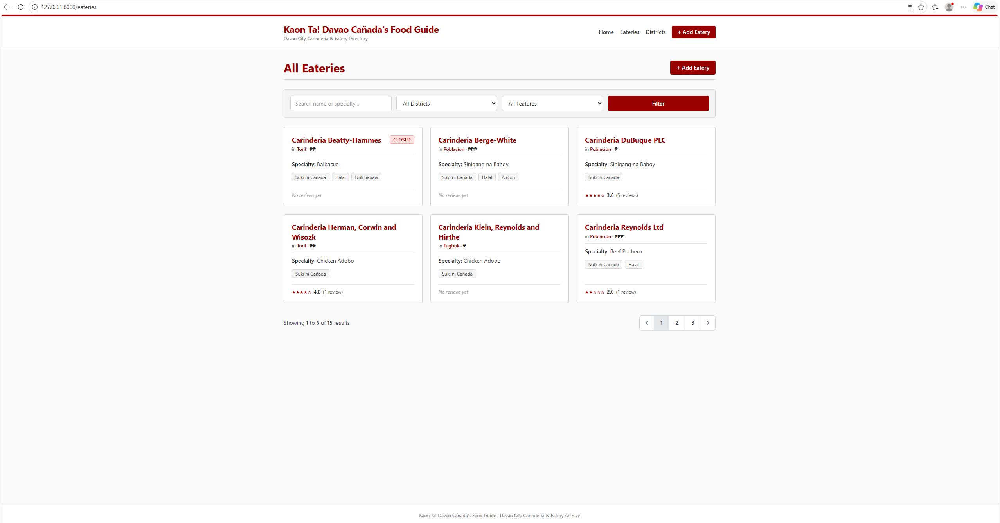
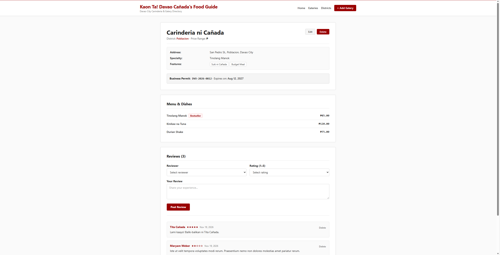
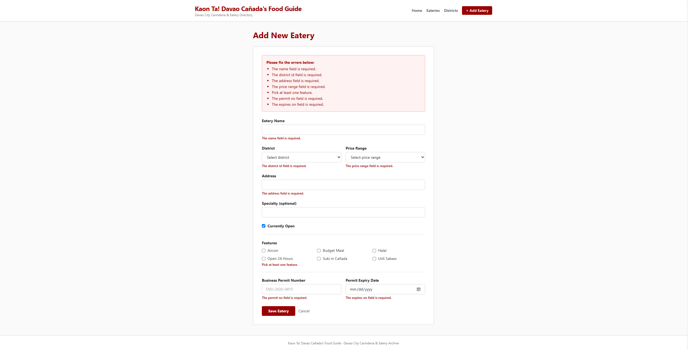

# Kaon Ta! Davao Cañada's Food Guide

**Name:** Rainzy Belle Cañada  
**Course:** 4-334 CS Elective 2 – Full-Stack Development (Laravel)  

A Davao City carinderia and eatery guide built with Laravel 12, SQLite, Blade components, and Tailwind CSS via Vite.

## Setup & Run Instructions

```bash
composer install
cp .env.example .env
php artisan key:generate
touch database/database.sqlite
php artisan migrate:fresh --seed
npm install
npm run build
php artisan serve
# or npm run dev while developing
```

## Personalized Seed Data

* **Districts (6):** Poblacion, Talomo, Agdao, Buhangin, Toril, Tugbok
* **Features (6):** Suki ni Cañada, Budget Meal, Halal, Open 24 Hours, Aircon, Unli Sabaw
* **Seeded Users (12 total):**
  * `Rainzy Cañada` (`canada@kaonta.test` / password: `kaonta2026`)
  * `Tita Cañada` (`tita.canada@kaonta.test` / password: `kaonta2026`)
  * Plus 10 factory resident users
* **Hand-Made Eatery:**
  * **Name:** Carinderia ni Cañada (`slug`: `carinderia-ni-canada`)
  * **District & Address:** Poblacion — San Pedro St., Poblacion, Davao City
  * **Business Permit:** `DVO-2026-0812` (Expires on `2027-08-12`)
  * **Dishes:** Tinolang Manok (₱85.00, Bestseller), Kinilaw na Tuna (₱120.00), Durian Shake (₱75.00)

## Eloquent Relationships

| Relationship | Type | Why This Type Fits |
| :--- | :--- | :--- |
| **District → Eatery** | `hasMany` / `belongsTo` | One Davao district contains many carinderias, while each carinderia belongs to a single district. |
| **Eatery → Dish** | `hasMany` / `belongsTo` | An eatery serves multiple menu dishes, and each dish belongs to the specific eatery that offers it. |
| **Eatery → Review** | `hasMany` / `belongsTo` | Residents can post many reviews on an eatery, and every review belongs to one target eatery. |
| **User → Review** | `hasMany` / `belongsTo` | A single resident user can write many reviews across the guide, while each review belongs to one author. |
| **Eatery → Permit** | `hasOne` / `belongsTo` | Each eatery holds exactly one official business permit, and each permit belongs to one specific eatery. |
| **Eatery ↔ Feature** | `belongsToMany` | An eatery can have multiple tags like Halal or Budget Meal, and each feature applies to many eateries through `eatery_feature`. |
| **District → Review** | `hasManyThrough` | A district collects all reviews written for the eateries located within it by traversing through the `eateries` table. |

## Route List (`php artisan route:list --except-vendor`)

```text
  GET|HEAD        / ........................................................................ home › HomeController
  GET|HEAD        districts ................................................ districts.index › DistrictController@index
  GET|HEAD        districts/{district} ....................................... districts.show › DistrictController@show
  GET|HEAD        eateries ................................................... eateries.index › EateryController@index
  POST            eateries ................................................... eateries.store › EateryController@store
  GET|HEAD        eateries/create .......................................... eateries.create › EateryController@create
  GET|HEAD        eateries/{eatery} ............................................ eateries.show › EateryController@show
  PUT|PATCH       eateries/{eatery} ........................................ eateries.update › EateryController@update
  DELETE          eateries/{eatery} ...................................... eateries.destroy › EateryController@destroy
  GET|HEAD        eateries/{eatery}/edit ....................................... eateries.edit › EateryController@edit
  POST            eateries/{eatery}/reviews .......................... eateries.reviews.store › ReviewController@store
  GET|HEAD        reviewers/{user} .......................................... reviewers.show › ReviewerController@show
  DELETE          reviews/{review} ........................................ reviews.destroy › ReviewController@destroy
```

## Screenshots

### 1. Eatery List & Filters


### 2. Eatery Page with Reviews


### 3. Create Eatery Validation Errors
